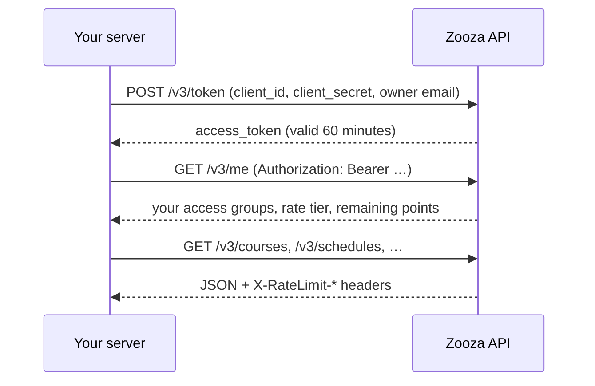

import AiPrompt from '@site/src/components/AiPrompt';

# API overview

The Zooza API gives your integration access to a Zooza company's programmes, classes, sessions, registrations,
attendance and invoices. It is a JSON-over-HTTPS API: you exchange an API key for an access token, then call the
operations your key's access groups allow.

:::tip New here?
[Getting started](getting-started.md) takes you from an API key to your first successful call in about ten minutes.
:::

## When to use the API

Zooza offers two ways to integrate: **widgets** (embeddable booking, calendar, profile and map components) and the
**API** (programmatic access from your server). Many integrations use both.

**Use widgets** when you want ready-made Zooza components on your website. They need no server code and no API key:
see the [widget docs](../widgets/index.md).

**Use the API** when you need to:

- build back-office tools or reports on top of Zooza data;
- show programmes and classes in your own website design, from data you cache on your server;
- synchronise registrations, sessions or invoices with another system (CRM, accounting, ERP).

The API is called from a **server**. Your key's secret must never reach a browser or a mobile app; see
[Security](keys.md#security).

## How it works

1. **Get a key.** A company owner creates it in the Zooza app under **Developers → API keys**. See
   [Keys](keys.md).
2. **Exchange it for a token.** `POST /v3/token` returns a bearer token that lasts 60 minutes. See
   [Authentication](authentication.md).
3. **Call the API** with `Authorization: Bearer <access_token>`. What you may call depends on your key's access
   groups; every call costs points from your company's budget. See [Access and rate limits](access-and-rate-limits.md).

## Regions and base URLs

Each region has its own host. A key belongs to the region of the company that created it, and works only there.

| Region | Base URL |
|---|---|
| EU | `https://api.zooza.app/v3` |
| UK | `https://uk.api.zooza.app/v3` |
| ASIA | `https://asia.api.zooza.app/v3` |

Examples in these docs use the EU base URL. Use your company's region instead; `GET /v3/me` returns it as `region`.

## What the API covers

| Resource | Zooza term | What you can do | Reference |
|---|---|---|---|
| Programmes | [programme](../concepts.md#programme-course) (`courses`) | List, read, create, update | [Programmes](/api/reference#tag/programmes) |
| Classes | [class](../concepts.md#class-group) (`schedules`) | List, create, update | [Classes](/api/reference#tag/classes) |
| Sessions | [session](../concepts.md#session-lessoneventterm) (`events`) | List, read, create, update one or several | [Sessions](/api/reference#tag/sessions) |
| Calendar | sessions by date | Read a calendar of sessions | [Calendar](/api/reference#tag/calendar) |
| Attendance | attendance register | Read a session's register | [Attendance](/api/reference#tag/attendance) |
| Registrations | registration | Search, read, update | [Registrations](/api/reference#tag/registrations) |
| Extra fields | custom registration fields | Set and update values | [Extra fields](/api/reference#tag/extra-fields) |
| Invoices | customer invoices | List, read, create, download | [Invoices](/api/reference#tag/invoices) |
| Company | [venues](../concepts.md#place-locationvenue) (`places`) | List venues | [Company](/api/reference#tag/company) |
| Users | company users | List | [Users](/api/reference#tag/users) |
| Agreements | terms and consents | Read an agreement version | [Agreements](/api/reference#tag/agreements) |

If an operation is not in the [API reference](/api/reference), it is not part of the API. The API uses the database
names (`courses`, `schedules`, `events`); the Zooza app shows programme, class and session. The
[glossary](../concepts.md) maps the two.

## Good to know

A few things that catch first integrations. Each links to the full rule in the reference.

- **Lists come in more than one shape.** Most lists return `{total, page, page_size, settings, data}` with a
  zero-based `page`, but `GET /v3/courses` is a plain array and `GET /v3/registrations` returns
  `{total, total_capped, page, offset, results}`. See
  [Lists and pagination](/api/reference#description/lists-and-pagination).
- **Pages start at 0, and `total` stops at 500.** On `GET /v3/registrations`, `total_capped: true` means there are
  more, and the pages go on past 500. `page` comes back `null`, so use `offset`. See
  [Find registrations](guides/find-registrations.md#4-page-through-the-results).
- **Searching registrations needs `advanced_search=1`.** Always send it on
  [`GET /v3/registrations`](/api/reference#tag/registrations/GET/registrations). Without it the API answers `422`
  naming the missing parameter.
- **Dates and times are local to the region**: `Europe/Bratislava` for EU, `Europe/London` for UK, `Asia/Dubai`
  for ASIA. See [Dates and times](/api/reference#description/dates-and-times). Times of day are **minutes after
  midnight** (`570` = 9:30). Timestamps such as `created` look like `2026-11-20 18:21:34`, without `T` or a time zone.
  A class with no sessions yet has `start` `"0000-00-00"`.
- **Whether amounts include VAT depends on the company's setting.** See
  [Amounts](/api/reference#description/amounts).
- **Error messages are in the company's language**, not one your request chooses. Build logic on error codes, not
  on message text. See [Errors](errors.md) and the [error code reference](error-codes.md).

## Machine-readable reference

The full reference is published as an OpenAPI 3 document, one per region, without authentication:

- `https://api.zooza.app/v3/openapi.json` (EU)
- `https://uk.api.zooza.app/v3/openapi.json` (UK)
- `https://asia.api.zooza.app/v3/openapi.json` (ASIA)

Use it to generate a client or to give an AI coding agent the exact contract.

<AiPrompt task="Build a Zooza API integration">{`Help me build a server-side integration against the Zooza API (/v3).

Read these first and do not invent endpoints:
- Guide: https://docs.zooza.online/api/getting-started
- Machine-readable reference: https://api.zooza.app/v3/openapi.json (use my region's host)

Facts:
- Authenticate with POST /v3/token (client_credentials) using client_id, client_secret and the email of an owner of my company. Read client_id, client_secret and the email from environment variables (a git-ignored .env locally). Never ask me to paste the secret into this chat.
- Send Authorization: Bearer <access_token>. Tokens last 60 minutes; cache and reuse them, request a new one when they expire.
- Calls cost points; respect 429 + Retry-After. GET /v3/me shows what my key may call and what is left.
- Keys act on live data. Ask me before writing code that creates or changes anything.

What I want to build:
[describe your use case — e.g. "export this term's registrations to CSV", "show my classes on my website", "sync new registrations into my CRM"]

Language: [Node.js / Python / PHP / other]`}</AiPrompt>

## Next steps

- [Getting started](getting-started.md): key → token → first call
- [Authentication](authentication.md): the token request in full
- [Access and rate limits](access-and-rate-limits.md): access groups, company scope, points and tiers
- [Errors](errors.md): status codes and error bodies
- [Error codes](error-codes.md): every `400` error code and what it means
- Guides: [Find registrations](guides/find-registrations.md), [Change a registration](guides/change-a-registration.md),
  [Set up a term](guides/set-up-a-term.md)
- [Keys](keys.md): creating, rotating and revoking keys, and security practices
- [API reference](/api/reference): every operation
