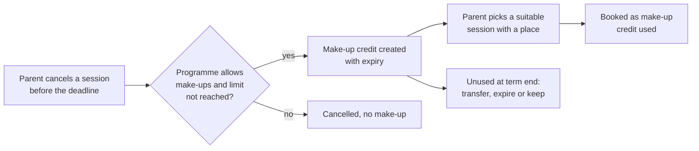

import AiPrompt from '@site/src/components/AiPrompt';

# How make-up sessions work

Make-up sessions (also called replacement classes; SK *náhradné hodiny*, CZ *náhradní hodiny*, DE *Nachholtermine*) are one of the hardest parts of running term-based classes. Parents expect to make up a missed class. The business needs that to stay fair, limited and inside capacity. Zooza enforces the rules automatically, so your website, app or AI assistant doesn't have to.

## Why it's hard to build yourself

A make-up system that holds up in real life needs:

- a record of *which* session was missed and whether it was cancelled in time,
- per-programme rules: allowed or not, how many per booking, how long they stay valid, and where they can be used,
- a search for sessions that are suitable (same programme, right age, right venue, not already attended) and still have a place,
- seats for make-ups in classes that are full for regular bookings,
- a waiting list when nothing is free, and race-safe booking when two parents click at once,
- what happens to unused make-ups at the end of term,
- emails for every step, and reporting so the owner can see what's outstanding.

## The lifecycle

### 1. Earning a make-up

A make-up is earned when a session of a booking is **cancelled before the cancellation deadline**. The parent can cancel in the [profile widget], or staff can mark the attendance as cancelled. A make-up credit is created only if:

- the programme has make-ups enabled,
- the booking hasn't reached its make-up limit,
- the cancellation is on time (a late cancellation is refused, or recorded as a no-show without a make-up, depending on company settings),
- the cancelled session wasn't itself a make-up.

Make-ups apply to term-based programmes, where a client books a whole class. If an instructor later changes "Cancelled" to "Did not attend", the make-up is removed again.

:::note Make-up ≠ free credits
A **make-up** is *earned* by cancelling a session in time. **Free credits** are extra sessions an admin *grants* on a booking. A **cancelled session** (the whole class didn't run) is credited to the payment, not turned into a make-up. They are separate features with separate rules.
:::

### 2. Limits and expiry

| Rule | Set on | What it does |
|---|---|---|
| Make-ups allowed | Programme | Master switch. Must be on for both the original and the target programme. |
| Limit per booking | Programme | Maximum make-ups a booking can earn. Can scale with the number of sessions in the class. Individual bookings can get extra make-ups. |
| Validity | Company / programme | Make-ups expire after a set number of days (default 90). They can also be capped relative to the class end date. |
| Booking cut-off | Company | How many hours before a session it can still be booked as a make-up. |
| End of term | Company | Unused make-ups are **transferred** to the next term (up to a limit, with a new expiry), **expired**, or **left as is**. |

### 3. Where a make-up can be used

Each programme decides where its make-ups can be booked: **in the same class**, **in the same programme**, **anywhere in the company**, or in a **selection** of programmes, billing periods and venues. The rule is copied onto the make-up when it's created, so later setting changes don't affect make-ups already earned.

Linked companies (for example franchise networks) can allow **cross-company make-ups**. Both programmes must opt in, and attendance data stays separated per company.

### 4. Capacity: make-ups in full classes

A class has a regular **capacity** for bookings, plus optional **extra capacity** that only make-ups and trials can use. A class can therefore be "full" for new sign-ups but still accept a make-up. Extra capacity can be set on the class and company-wide, and the class decides whether the two are added together or the class value replaces the company one.

When a parent books, Zooza re-checks the place at that moment and locks the session, so two parents can't take the last seat at the same time.

If nothing suitable is free and the programme allows it, the parent can join a **make-up waiting list** and accept the place when it opens.

### 5. Variants

- **Custom make-ups:** for private or 1-to-1 lessons, the parent proposes a date and time instead of picking a session. Requests are approved automatically or by the instructor, depending on the programme.
- **Admin-managed make-ups:** parents can cancel, but only staff choose the make-up date. Parents can leave a preference note.
- **Make-ups as money:** if the programme allows it, unused make-ups from paid bookings can be used as credit towards a payment.
- **Cancelling a booked make-up:** depending on the programme, parents can cancel a booked make-up themselves, and the original make-up becomes available again.

## Using make-ups in your integration

### On your website: the profile widget

The [profile widget] gives parents the full flow without any code: cancel a session, see their make-ups and when they expire, find a suitable session with a place, book it, join the waiting list, or cancel a make-up. All rules above are applied.

Combine it with:

- [Branded booking tiles](./examples/branded-booking-tiles.md), so the booking and profile pages look like your site,
- [the AI chatbot example](./examples/chatbot-logged-in-client.md), so your chatbot can offer *"Book a make-up for last Tuesday?"* to a logged-in parent.

### From your backend: the REST API

| Task | API |
|---|---|
| Cancel a session for a client (earns a make-up if the rules allow) | `PUT /registrations/{id}` with attendance `canceled`. See [Update a registration](/api/reference/update-a-registrations-based-on-parameters-sent-in-body). |
| Book a make-up into a specific session | `PUT /registrations/{id}` with action `set_replacement`, `credit_id` and `event_id` |
| Give one booking extra make-ups | `PUT /registrations/{id}` with `extra_replacements_limit` |
| Read programme make-up settings | [`GET /courses/{id}`](/api/reference/get-list-of-courses): `allow_replacements`, `replacements_limit`, `replacements_settings`, `allow_replacements_waitlist`, … |
| Make-up capacity of a class | [`GET /schedules`](/api/reference/get-list-of-schedules): `extra_capacity`, `extra_capacity_usage` |

All changes go through the same rules as the widget, so an API call can't book a make-up the business doesn't allow.

### From an AI assistant

With the [Zooza MCP server](./ai-assistants.md#zooza-mcp-server), staff can ask *"Mark Emma as cancelled for Saturday"* or *"Who has unused make-ups expiring this month?"*, and Zooza applies the same rules.

## Related

- [Concepts: sessions, classes, programmes](./concepts.md)
- [Terms in other languages](./concepts.md#terms-in-other-languages)
- [Profile widget][profile widget]

[profile widget]: ./widgets/profile-widget.md

<AiPrompt task="Add make-ups to my integration">{`My business uses Zooza and I want parents to handle make-up sessions on my website (or in my app).

Read first: https://docs.zooza.online/make-up-sessions/ and https://docs.zooza.online/llms-full.txt

Tasks:
1. Ask whether I want the no-code route (profile widget) or a custom UI on the REST API.
2. For the widget: add the profile widget to my "Parent zone" page and match my styling.
3. For the API: build server-side endpoints for cancelling a session and booking a make-up (set_replacement), keeping all Zooza credentials on the server.
4. Never re-implement the make-up rules in my code — rely on Zooza's checks and show its error messages.`}</AiPrompt>
